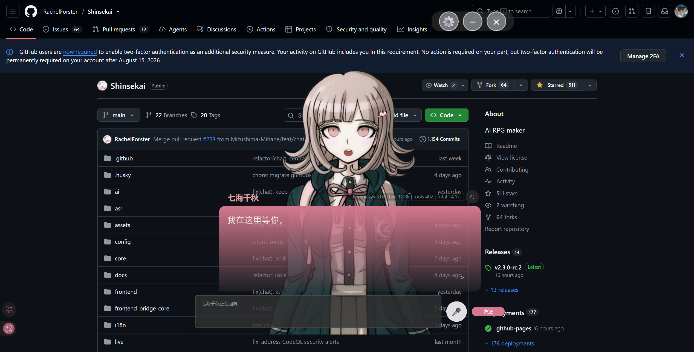
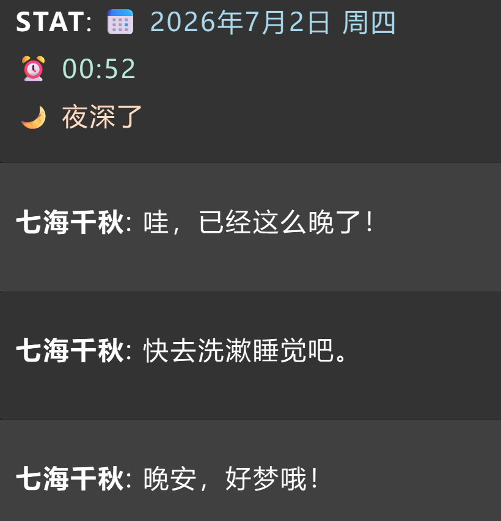

# Heartbeat Companion｜心跳陪伴

让 Shinsekai 角色不必等你先开口。

你安静一会儿后，角色会自然地接着聊天、主动问候，或结合当前时间和屏幕内容说点什么。你一发消息，它就重新计时；角色还在回复或播放语音时，也不会插队打断。



## 能做什么

- 在随机空闲时间后主动说话，不会机械地卡点触发。
- 在识屏、自言自语、主动提问之间按权重随机选择。
- 参考最近几条对话和空闲时长，尽量接得上当前话题。
- 避免连续重复同一种模式、固定问题或语气词。
- 可选接入 Moondream Vision；没有安装时仍可正常使用其他模式。

<p align="center">
  
</p>

## 三分钟上手

要求：Shinsekai 2.1.0 或更高版本。

1. 打开 Shinsekai 的 **设置 → 插件**。
2. 在插件市场搜索 **Heartbeat Companion**，点击安装并启用。
3. 完整重启 Shinsekai。
4. 回到插件页面，打开 Heartbeat Companion 的配置。

插件不要求 Moondream，也没有额外的 Python 依赖。只想让角色偶尔主动说话，保持默认设置就能直接用。

<details>
<summary>插件市场找不到时：手动安装</summary>

1. 在本仓库点击 **Code → Download ZIP** 并解压。
2. 新建 `Shinsekai/plugins/heartbeat_companion/`，把仓库文件复制进去。
3. 确认 `plugin.py` 直接位于该目录，不要多套一层文件夹。
4. 在 `Shinsekai/data/config/plugins.yaml` 末尾追加：

```yaml
- entry: plugins.heartbeat_companion.plugin:HeartbeatCompanionPlugin
  enabled: true
```

保存后完整重启 Shinsekai。不要删除 `plugins.yaml` 中已有的其他插件。

</details>

## 怎么设置

设置页里最常用的是这些：

| 设置 | 怎么填 |
| --- | --- |
| 最短 / 最长空闲时间 | 每轮会在两者之间随机等待；日常可先用 `5–15` 分钟 |
| 自适应空闲策略 | 开启后，短空闲更偏向延续对话，长空闲更偏向识屏和固定问题；关闭后严格使用下方基础权重和概率 |
| 三种模式权重 | 数字代表基础相对概率；某项填 `0` 就会关闭该模式 |
| 回复句数 | 控制每次大约说几句，建议 `1–4` |
| 固定问题 | 每行一个问题，触发时随机抽取一条 |
| 常用语气词 / 动作 | 每行一条，例如 `唔……`、`（打哈欠）`、`😊` |
| 提示词 | 整个输入框是一条完整指令，可直接写中文；换行不会变成多条随机提示词 |

想快速确认插件是否工作，可临时把空闲时间改为 `0.1–0.2` 分钟，也就是 6–12 秒。测试结束后再改回正常时间。

配置保存后通常立即生效，不需要重启。更新插件代码或版本后才需要重启。

<details>
<summary>我想直接修改 config.json</summary>

配置文件位于：

```text
Shinsekai/data/plugins/io.github.hard_to_tell.heartbeat_companion/config.json
```

例如，只保留自言自语和提问：

```json
"mode_weights": {
  "screen": 0,
  "monologue": 50,
  "question": 50
}
```

文字要放在英文双引号中，项目之间使用英文逗号，最后一项后面不要加逗号。JSON 暂时写错时，插件会继续使用上一份有效配置。

</details>

## 可选识屏

安装并启用 [Shinsekai Moondream Vision](https://github.com/RachelForster/Shinsekai-Moondream-Vision) 后，识屏模式会调用它的 `moondream_query_screen` 工具。识屏不可用或失败时，本次心跳会自动改成自言自语或提问。

建议关闭 Moondream 自带的自动监屏触发，只保留识屏工具，避免两个插件同时主动说话。Heartbeat Companion 不保存截图或识屏摘要。

## 没有触发？

- 确认插件已启用，并在安装或更新后完整重启过 Shinsekai。
- 测试时把空闲时间设为 `0.1–0.2` 分钟，并保持聊天窗口开启。
- 用户刚发送消息、角色正在回复或 TTS 正在播放时，计时会重新开始。
- 只关闭识屏模式不会影响自言自语和提问模式。

开发结构与测试方法见 [docs/DEVELOPMENT.md](docs/DEVELOPMENT.md) 和 [docs/ARCHITECTURE.md](docs/ARCHITECTURE.md)。

MIT License
